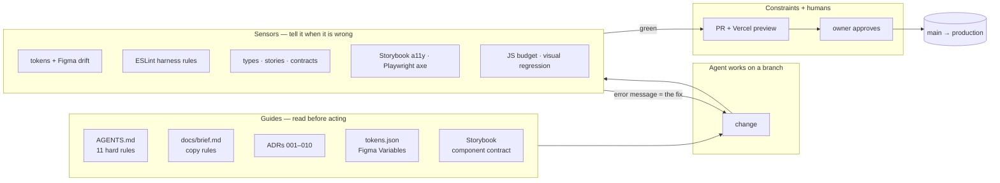

# Otakoyi — a design system as a harness

**Sales site for a generative installation studio, built so that AI coding agents can ship
on-brand, accessible UI without being able to break it.**

[Live site](https://studio-portfolio-navy.vercel.app) · [Storybook](https://studio-portfolio-storybook.vercel.app) ·
[Figma](https://www.figma.com/design/7fyYBxvBHHEK4IKO6ZTkXN/Draft) · [Metrics](docs/metrics.md) ·
[Decisions](docs/decisions/README.md)

> Design engineering by Yura Danilov — positioning, Figma library, design system, code, CI and the
> agent workflow. Most code was written by AI agents (Claude Code) inside the harness described below.

---

## The problem

Agents write UI fast, and drift just as fast: a hex colour here, a hand-rolled button there, a
heading level skipped, three.js pulled into the initial bundle, a token renamed in Figma and never
in code. Review catches some of it, late and by eye. The goal was to make the right thing the
only thing that passes — for agents and humans alike.

## The approach: guides, sensors, constraints



- **Guides** feed the agent before it starts: `AGENTS.md` is the harness (stack, 11 hard rules,
  workflow, checkpoints), `docs/brief.md` the positioning and copy rules, ADRs the decisions it
  must not relitigate, Storybook the component contract.
- **Sensors** give mechanical, fast feedback. Every rule in `AGENTS.md` has one, and every
  failure message says how to fix it — so an agent can repair its own work without a human.
- **Constraints** remove options instead of adding review: WebGL is quarantined to one folder,
  primitives come only from the design system, everything lands through a PR with a preview,
  and production releases wait for the owner.

## Key pieces

### One token contract, two tools

`tokens/tokens.json` (OKLCH, dark + light) is the source of truth. `pnpm tokens` generates the
shadcn CSS variables and a hex palette for WebGL shaders and OG images. In Figma the same names
live as Variables (collection _Theme_), each bound to a swatch on the _Tokens_ page.

`pnpm tokens:figma:pull` reads those swatches through the Figma REST API — on any plan, where the
Variables API is Enterprise-only — into `tokens/figma.json`. `pnpm tokens:figma:check` compares
both sides by perceptual distance (CIEDE2000 ΔE ≤ 1) and alpha, in every `pnpm verify` and CI run.
A weekly workflow pulls Figma and opens a PR when a designer changed something:

```text
✗ tokens.json and Figma (snapshot 2026-10-16) have drifted:
  - signal.dark: code #a2d128 vs Figma #c1f354 (ΔE 7.88)
  Fix: change the side that is wrong. Design changed in Figma → update tokens/tokens.json …
```

### Code Connect for every Figma component

All 25 components in the Figma library are accounted for in `figma/components.json`: 20 are
connected to their React counterparts with Code Connect templates (`figma/*.figma.ts`), 5 are
Figma-only parts rendered inside a section. A contract test fails on a missing template, a wrong
node, an orphan, or an import that doesn't exist in code — so the design library and the codebase
can't silently diverge. ([ADR-010](docs/decisions/010-figma-code-contract.md))

### Lint rules that encode the design system

Five custom ESLint rules: no raw colours, no Tailwind palette colours, `radix-ui` only inside the
design system, `three` only inside the generative engine, `@/` imports only. Each message names the
token or component to use instead.

### Accessibility as a test

Storybook runs axe in `error` mode on every story; Playwright runs axe (WCAG 2.2 AA) on every
route at three viewports, including axe's best-practice rules such as heading order.
Accessibility regressions fail CI like type errors.

### A generative engine with a contract

Every visual on the site is a fragment shader behind one component —
`<GenerativeWork work seed palette density />` — colours from tokens, deterministic per seed, lazy
loaded, paused off-screen. Determinism is what makes screenshot tests of live WebGL possible.

### Performance as a budget

Initial JS is capped at 230 KB gzip per route and three.js must never be in it
(`pnpm check:budget`). Analytics load as deferred platform scripts so they cost the bundle nothing.

### SEO and GEO from content

Canonical URLs, generated Open Graph cards per page, `sitemap.xml`, JSON-LD (Organization, Service,
CreativeWork, FAQPage, breadcrumbs) and `/llms.txt` are all built from the same typed content as the
pages, so they never drift from what the site says.

## Results

|                      |                                                             |
| -------------------- | ----------------------------------------------------------- |
| Lighthouse (desktop) | Performance 99–100 · Accessibility 100 · SEO 100            |
| Lighthouse (mobile)  | Performance 87–99 · Accessibility 100 · CLS 0               |
| axe                  | 0 violations — 60 stories, 61 e2e checks across 3 viewports |
| JS budget            | max 227 KB of 230 KB, three.js lazy everywhere              |
| Figma ↔ code         | 24 / 24 tokens in sync · 25 / 25 components accounted for   |
| Delivery             | 28 PRs in two weeks, 13 CI sensors, 10 ADRs                 |

Full numbers and how to reproduce them: [docs/metrics.md](docs/metrics.md).

## Honest notes

- Pump The Market and The Whale are the studio's own R&D installations; the other cases are
  placeholders until real projects ship. Visuals on the site are generated or rendered.
- Code Connect templates are validated in CI and published from `main` by a workflow.

## Run it

```bash
pnpm install
pnpm dev            # site on :3000
pnpm storybook      # component workshop on :6006
pnpm verify         # fast sensors
pnpm verify:full    # + build, JS budget, Playwright e2e/axe
```

Stack: Next.js 16 (App Router) · TypeScript strict · Tailwind v4 · shadcn/ui · React Three Fiber +
GLSL · MDX · Storybook 10 · Vitest · Playwright · Vercel. Start with [AGENTS.md](AGENTS.md).
