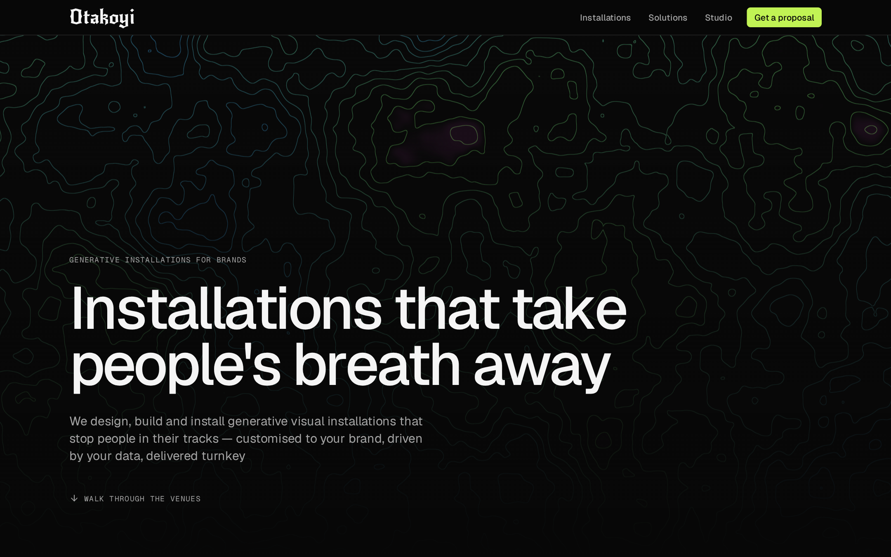
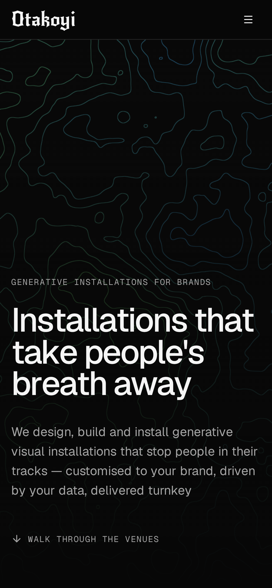
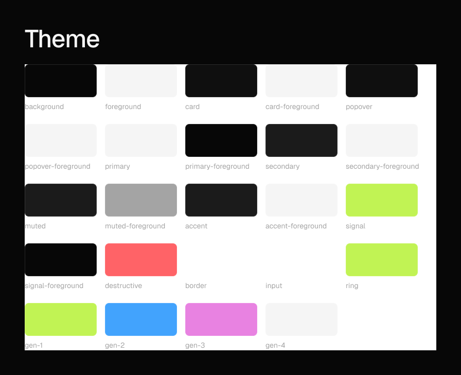
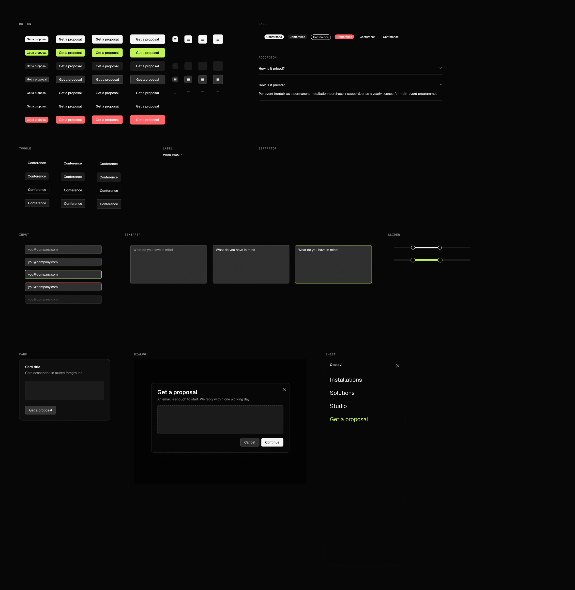
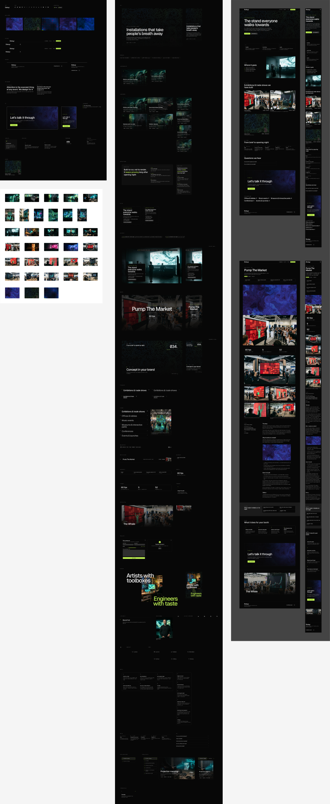
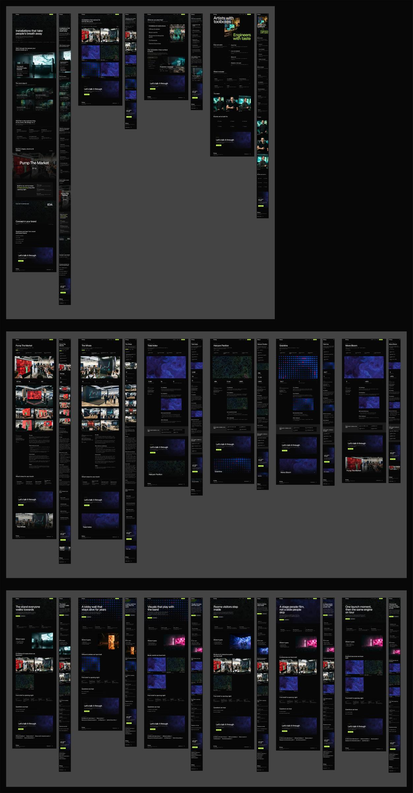
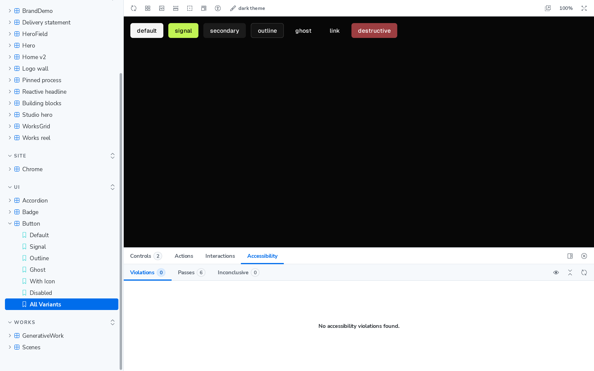
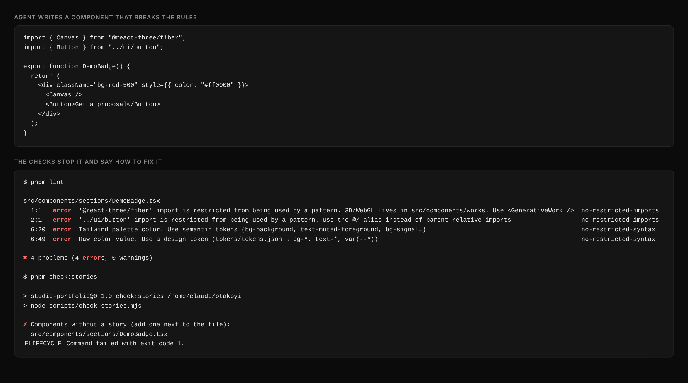
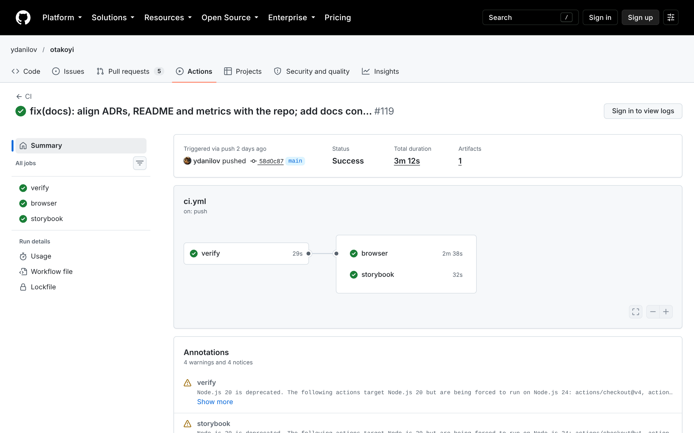
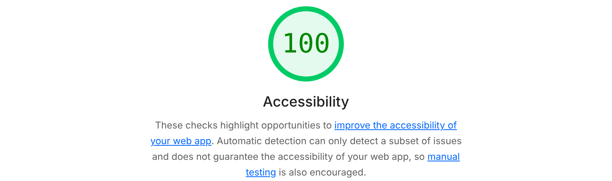

# How this site was built

Screenshots taken on 21 October 2026. The site is a draft: the studio is just launching, so the cases and numbers on it are placeholders.

## 1. The live site

This is the result, running in production.

| Desktop                                    | Mobile                                   |
| ------------------------------------------ | ---------------------------------------- |
|  |  |

## 2. Figma: from colours to full pages

The design was built bottom-up, and each step uses only the step before it.

**Colours (tokens).** Every colour has a name, like `background` or `signal`. The code uses the same names, so Figma and the site never disagree.

**Basic components.** Buttons, fields, cards and so on. They are the same components the site uses in code, painted with the colours above.

**Sections.** Bigger blocks of the site, assembled from the basic components.

**Pages.** Every page of the site, on desktop and mobile, assembled from sections.

## 3. Storybook: every component on its own

Each component can be opened and checked separately from the site, in every state. Accessibility is checked automatically. Here the result is "0 problems".

## 4. Checks that keep the AI on track

An example: the AI writes a component that breaks the rules (a random colour, a 3D library in the wrong place, no documentation). The checks block it, and each message says how to fix the problem. The AI fixes it before a person ever reviews the change.

## 5. Every change is checked before it goes live

Each change runs all checks automatically. Only a fully green change can reach the site.

## 6. Accessibility score

