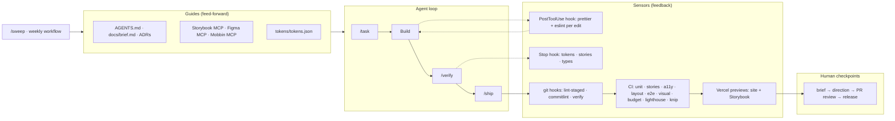

# Harness workflow

> **Agent = Model + Harness.** The harness is everything around the agent that makes good work the
> default: the repo as the system of record, rules it reads before acting, sensors that tell it —
> mechanically and fast — when it went wrong, and constraints it cannot cross.



## The four layers

| Layer                  | Purpose                               | In this repo                                                                                                                                                                               |
| ---------------------- | ------------------------------------- | ------------------------------------------------------------------------------------------------------------------------------------------------------------------------------------------ |
| **Guides**             | What the agent knows before it starts | `AGENTS.md`, `docs/brief.md`, `docs/decisions/`, `docs/research/`, tokens, `.mcp.json` (Storybook, Figma, Playwright), `.claude/skills/*`                                                  |
| **Sensors**            | What tells the agent it is wrong      | Claude hooks (per edit, before stop), git hooks, CI jobs, Vercel previews — table below                                                                                                    |
| **Constraints**        | What the agent may not do             | `.claude/settings.json` deny-list (no push to `main`, no force push, no prod deploy, no editing generated files or baselines, no reading secrets), ESLint harness rules, branch protection |
| **Garbage collection** | Keeping entropy down                  | `/sweep` command + weekly `sweep.yml` issue, Dependabot (grouped)                                                                                                                          |

## Agent toolkit (`.claude/`)

| Kind     | Name                  | Use                                                                       |
| -------- | --------------------- | ------------------------------------------------------------------------- |
| Command  | `/task <goal>`        | Full loop: brief → reference → design → branch → build → verify → ship    |
| Command  | `/verify`             | Every sensor in order, table of results                                   |
| Command  | `/ship`               | Push branch, open PR from template, wait for CI, stop at human checkpoint |
| Command  | `/sweep`              | Garbage collection into a cleanup PR                                      |
| Command  | `/figma-sync <scope>` | Tokens / components / pages between code and Figma                        |
| Subagent | `reviewer`            | Diff review against harness rules before a PR                             |
| Subagent | `a11y-auditor`        | Keyboard, focus, motion, contrast beyond axe                              |
| Subagent | `design-parity`       | Figma frame vs rendered UI drift report                                   |
| Skill    | `new-component`       | Scaffold component + story + Figma counterpart                            |
| Skill    | `new-case`            | Add a case study without inventing results                                |
| Hook     | PostToolUse           | Format + lint every edited file; block edits to generated files           |
| Hook     | Stop                  | Tokens, story coverage and types must be green before "done"              |

## Sensors — what runs where

| Sensor                                                                                                                                                       | Command                | Agent hook | git hook   | CI         |
| ------------------------------------------------------------------------------------------------------------------------------------------------------------ | ---------------------- | ---------- | ---------- | ---------- |
| Format                                                                                                                                                       | `pnpm format:check`    | per edit   | pre-commit | ✓          |
| Lint + harness rules (tokens only, DS imports, WebGL quarantine)                                                                                             | `pnpm lint`            | per edit   | pre-commit | ✓          |
| Tokens in sync                                                                                                                                               | `pnpm tokens:check`    | stop       | pre-commit | ✓          |
| Types (incl. route types)                                                                                                                                    | `pnpm typecheck`       | stop       | pre-push   | ✓          |
| Story coverage (every component, incl. `ui/`)                                                                                                                | `pnpm check:stories`   | stop       | pre-push   | ✓          |
| Dead code / unused deps                                                                                                                                      | `pnpm check:deadcode`  | —          | —          | ✓          |
| Content + token contracts                                                                                                                                    | `pnpm test`            | —          | pre-push   | ✓          |
| Storybook: interactions + a11y + **layout** (overflow, overlap, clipped text) on every story                                                                 | `pnpm test:stories`    | —          | pre-push   | ✓          |
| JS budget, lazy three.js                                                                                                                                     | `pnpm check:budget`    | —          | —          | ✓          |
| E2E + axe (3 viewports)                                                                                                                                      | `pnpm test:e2e`        | —          | —          | ✓          |
| **Layout contract** per route × viewport: overflow, overlap, one h1 / no skipped levels, sticky header, 1280 container, labelled works, proposal CTA, footer | `pnpm test:layout`     | —          | —          | ✓          |
| Visual regression (3 viewports × dark/light)                                                                                                                 | `pnpm test:visual`     | —          | —          | ✓ (Docker) |
| Lighthouse: a11y ≥ 0.95, SEO ≥ 0.9, BP ≥ 0.9 (blocking), perf ≥ 0.8 (warn), CLS < 0.1                                                                        | `pnpm test:lighthouse` | —          | —          | ✓          |
| Commit / PR title convention                                                                                                                                 | commitlint             | —          | commit-msg | ✓          |

Visual baselines are environment-specific. They are created and updated **only** by the
"Update visual baselines" workflow (manual, human-triggered), which commits them to the branch.

## Loop per task

1. **Brief** — GitHub issue with acceptance criteria (template: _Task_). 🧑 checkpoint
2. **Reference** — 3–5 Mobbin references → `docs/research/<topic>.md`. 🧑 checkpoint on direction
3. **Design** — Figma frame in "Draft", built only from library components and Variables.
4. **Build** — agent reads the frame via Figma MCP, composes from `ui/` + `sections/`; hooks lint every edit.
5. **Story** — every new/changed component: states + `play` tests; layout + a11y sensors run automatically.
6. **Verify** — `/verify` until green.
7. **Ship** — `/ship`: branch, PR, CI, Vercel previews (site + Storybook).
8. **Review** — 🧑 compare preview with Figma; merge.
9. **Release** — `main` auto-deploys to production. 🧑 checkpoint

## Sources of truth

```
Mobbin  ──references──▶  docs/research/
Figma Variables  ◀──mirror──▶  tokens/tokens.json  ──pnpm tokens──▶  CSS vars + TS
Figma components ◀──same names & props──▶  src/components/{ui,sections,site}
Code (git) is the final truth. Storybook is the living contract for every component.
```
